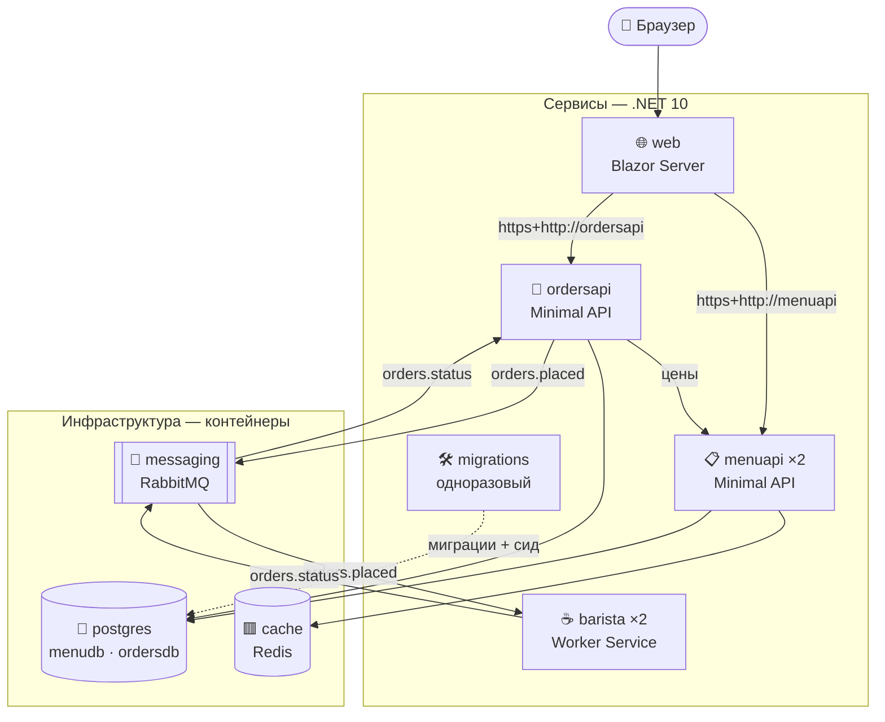

# ☕ CoffeeShop — учебный проект .NET Aspire + Blazor

Небольшая, но «настоящая» распределённая система онлайн-кофейни. Она нужна, чтобы на практике
разобраться с **.NET Aspire**: каждая основная возможность Aspire здесь используется по делу, а код
снабжён подробными комментариями на русском.

Пользователь выбирает напитки в Blazor-интерфейсе и оформляет заказ. Заказ уходит через RabbitMQ
«бариста», а статус обновляется на странице сам. За кулисами работают PostgreSQL, Redis, RabbitMQ,
шесть .NET-сервисов, а с одной командой `aspire run` всё это поднимает и связывает AppHost.



---

## 🚀 Быстрый старт

**Нужно установить:**

| Что | Зачем | Проверка |
|---|---|---|
| [.NET 10 SDK](https://dotnet.microsoft.com/download) | сборка и запуск (версия закреплена в `global.json`) | `dotnet --list-sdks` |
| [Docker Desktop](https://www.docker.com/products/docker-desktop/) (или Podman) | Aspire запускает PostgreSQL, Redis, RabbitMQ в контейнерах | `docker version` |
| Aspire CLI | команда `aspire` | `aspire --version` |

```powershell
# Aspire CLI ставится как глобальный dotnet tool
dotnet tool install -g Aspire.Cli

# HTTPS-сертификат разработчика (один раз на машину)
dotnet dev-certs https --trust
```

**Запуск:**

```powershell
aspire run
```

CLI найдёт AppHost (путь записан в `aspire.config.json`), соберёт решение, запустит контейнеры
и сервисы и выведет ссылку на **дашборд** вида `https://localhost:17xxx/login?t=...`. Открой её.
В дашборде у ресурса `web` есть ссылка **«☕ Открыть CoffeeShop»** — это приложение.

> Первый запуск дольше обычного: Docker скачивает образы PostgreSQL, Redis, RabbitMQ, pgAdmin, Redis Insight.
> Остановка — `Ctrl+C`. Контейнеры PostgreSQL и RabbitMQ при этом **не удаляются** (они «постоянные», см. урок 6).

Альтернативы: `dotnet run --project src/CoffeeShop.AppHost`, или F5 в Visual Studio / Rider
с AppHost в качестве стартового проекта.

---

## 📚 Учебный маршрут

Читай уроки по порядку. В каждом: **идея → где в коде → что посмотреть в дашборде → попробуй сам**.

| № | Урок | О чём |
|---|---|---|
| 0 | [Введение](docs/00-introduction.md) | Что такое Aspire, ключевые понятия, экскурсия по запущенному приложению |
| 1 | [AppHost и модель приложения](docs/01-apphost.md) | Ресурсы, `WithReference`, `WaitFor`, `WaitForCompletion`, реплики, что попадает в переменные окружения |
| 2 | [ServiceDefaults](docs/02-service-defaults.md) | OpenTelemetry, health checks, service discovery, resilience |
| 3 | [Интеграции](docs/03-integrations.md) | Хостинговые и клиентские пакеты: PostgreSQL + EF Core, Redis, RabbitMQ |
| 4 | [Дашборд и телеметрия](docs/04-dashboard-and-telemetry.md) | Логи, трейсы, метрики, свои спаны и метрики, команды ресурсов, ссылки |
| 5 | [Параметры и секреты](docs/05-parameters-and-secrets.md) | `AddParameter`, генерация паролей, `aspire secret` |
| 6 | [Контейнеры, тома, время жизни](docs/06-containers-and-volumes.md) | `WithDataVolume`, `ContainerLifetime.Persistent`, pgAdmin / Redis Insight, сброс данных |
| 7 | [Тестирование](docs/07-testing.md) | `Aspire.Hosting.Testing`: тесты модели и end-to-end тесты |
| 8 | [Публикация и деплой](docs/08-deployment.md) | `aspire publish` → Docker Compose, `aspire deploy` |
| 9 | [Упражнения и что дальше](docs/09-exercises.md) | Задания для самостоятельной практики |

---

## 🗺 Карта возможностей Aspire

| Возможность | Где в коде |
|---|---|
| Оркестрация: проекты, контейнеры, параметры | [AppHost.cs](src/CoffeeShop.AppHost/AppHost.cs) |
| `WithReference` — строки подключения и адреса сервисов | AppHost.cs → все сервисы |
| `WaitFor` / `WaitForCompletion` — порядок запуска | AppHost.cs (`migrations` → API → `web`) |
| `WithReplicas` — несколько экземпляров | `menuapi`, `barista` |
| Service Discovery (`https+http://menuapi`) | [Web/Program.cs](src/CoffeeShop.Web/Program.cs), [OrdersApi/Program.cs](src/CoffeeShop.OrdersApi/Program.cs) |
| ServiceDefaults: OpenTelemetry, health, resilience | [Extensions.cs](src/CoffeeShop.ServiceDefaults/Extensions.cs) |
| PostgreSQL + EF Core + миграции | [CoffeeShop.Data](src/CoffeeShop.Data), [MigrationService](src/CoffeeShop.MigrationService) |
| Redis (распределённый кэш) | [MenuEndpoints.cs](src/CoffeeShop.MenuApi/MenuEndpoints.cs) |
| RabbitMQ (сообщения + распределённый трейс) | [OrdersApi/Messaging](src/CoffeeShop.OrdersApi/Messaging), [Barista.cs](src/CoffeeShop.BaristaWorker/Barista.cs) |
| Свои трейсы (`ActivitySource`) и метрики (`Meter`) | [Barista.cs](src/CoffeeShop.BaristaWorker/Barista.cs), [OrdersMetrics.cs](src/CoffeeShop.OrdersApi/OrdersMetrics.cs) |
| Параметры и секреты | AppHost.cs, [appsettings.json AppHost](src/CoffeeShop.AppHost/appsettings.json) |
| Тома, persistent-контейнеры, pgAdmin, Redis Insight | AppHost.cs |
| Команды дашборда (`WithHttpCommand`) и ссылки (`WithUrlForEndpoint`) | AppHost.cs + [AdminEndpoints.cs](src/CoffeeShop.MenuApi/AdminEndpoints.cs) |
| Интеграционные тесты | [tests/CoffeeShop.Tests](tests/CoffeeShop.Tests) |
| Публикация в Docker Compose | AppHost.cs (`AddDockerComposeEnvironment`) |

---

## 🗂 Структура решения

```
├── aspire.config.json                 ← где лежит AppHost (для Aspire CLI)
├── global.json                        ← закреплённая версия .NET SDK (10)
├── dotnet-tools.json                  ← локальный инструмент dotnet-ef (миграции)
├── CoffeeShop.slnx                    ← файл решения
├── docs/                              ← уроки
├── src/
│   ├── CoffeeShop.AppHost/            ← 🎼 оркестратор: описание всей системы
│   ├── CoffeeShop.ServiceDefaults/    ← 🧰 общая обвязка всех сервисов
│   ├── CoffeeShop.Web/                ← 🌐 Blazor-фронтенд
│   ├── CoffeeShop.MenuApi/            ← 📋 меню (PostgreSQL + Redis)
│   ├── CoffeeShop.OrdersApi/          ← 🧾 заказы (PostgreSQL + RabbitMQ)
│   ├── CoffeeShop.BaristaWorker/      ← ☕ фоновый обработчик заказов
│   ├── CoffeeShop.MigrationService/   ← 🛠 миграции БД при старте
│   ├── CoffeeShop.Data/               ← EF Core: сущности, DbContext, миграции
│   └── CoffeeShop.Contracts/          ← DTO и сообщения, общие для сервисов
└── tests/
    └── CoffeeShop.Tests/              ← 🧪 тесты на Aspire.Hosting.Testing
```

---

## 🧰 Шпаргалка по Aspire CLI

```powershell
aspire run                          # запустить (интерактивно, Ctrl+C — остановить)
aspire start                        # запустить в фоне и вернуть управление
aspire ps                           # какие AppHost-ы сейчас запущены
aspire describe                     # таблица ресурсов: состояние, health, ссылки
aspire wait web --status healthy    # дождаться, пока ресурс станет Healthy
aspire logs menuapi                 # консольные логи ресурса
aspire otel traces                  # трейсы (то же, что вкладка Traces в дашборде)
aspire resource ordersapi rush-hour # выполнить команду ресурса ("Час пик")
aspire secret list                  # сохранённые параметры и секреты AppHost
aspire stop                         # остановить фоновый AppHost
aspire publish -o artifacts/compose # сгенерировать docker-compose.yaml
aspire deploy                       # собрать образы и поднять всё в Docker Compose
aspire destroy --yes                # удалить развёрнутое в Docker Compose
aspire docs search "WaitFor"        # поиск по документации Aspire прямо из терминала
```

Тесты: `dotnet test` (нужен запущенный Docker).

---

## ℹ️ Версии и заметки

- **Aspire 17.0** (CLI, хостинговые пакеты, шаблоны), **.NET 10 (LTS)**.
- В Aspire 17 проекты добавляются в AppHost через `AddDotnetProject("имя", "путь/к/проекту.csproj")`
  из пакета `Aspire.Hosting.Dotnet`. Старый `AddProject<Projects.X>()` объявлен устаревшим.
  В статьях и видео про Aspire 8–9 ты будешь встречать именно его, это нормально.
- Клиентская интеграция `Aspire.Npgsql.EntityFrameworkCore.PostgreSQL` взята стабильной версии **13.6.5**
  (EF Core 10). Версия 17.0 этого пакета пока выходит только как preview под EF Core 11. Клиентские и хостинговые
  пакеты общаются только через строку подключения, поэтому разные версии мирно уживаются. Подробнее в уроке 3.

## 🩺 Если что-то не работает

| Симптом | Что сделать |
|---|---|
| Контейнеры не стартуют, ошибка про Docker | Запусти Docker Desktop и проверь `docker version` |
| Браузер ругается на сертификат | `dotnet dev-certs https --trust` |
| `postgres` или `messaging` в состоянии ошибки «authentication failed» | Пароль в хранилище секретов не совпадает с данными в томе. Сбрось данные (урок 6) |
| Хочу начать с чистой базы | Урок 6, раздел «Как всё сбросить» |
| Ресурс красный в дашборде | Открой его **Console logs**: там почти всегда видна причина |
| `dotnet build` ругается «file is locked by CoffeeShop.…» | Приложение ещё запущено. Останови его (`Ctrl+C` / `aspire stop`), подожди пару секунд и собери снова. Пересобрать один сервис на лету можно командой **Rebuild** в дашборде |
| `aspire resource menuapi ...` → «Resource not found» | У ресурса с репликами укажи имя реплики из `aspire describe`, например `menuapi-abcd1234` |
